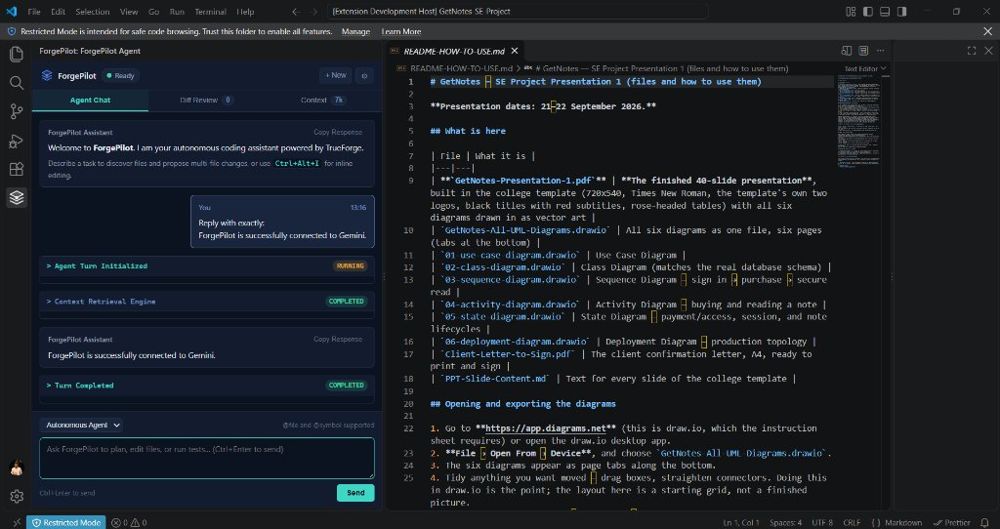
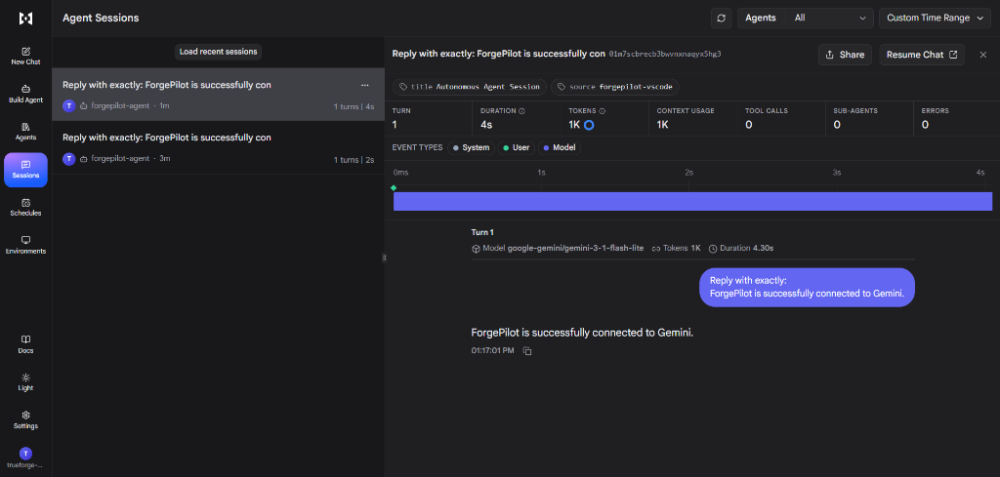
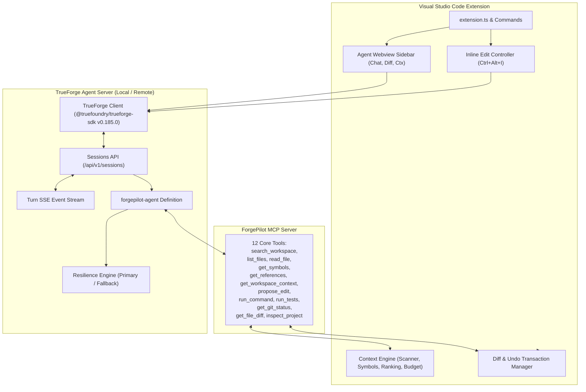
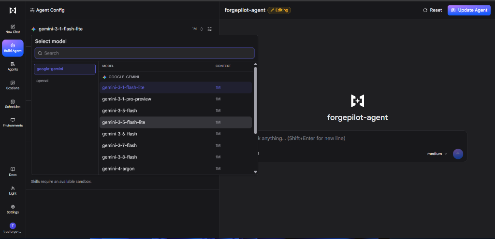

# ForgePilot

> **Autonomous AI Coding Assistant for Visual Studio Code powered by TrueForge**  
> *"Your repository. Your context. Your control."*

Built from scratch for the **Techfest 2026–27 TrueFoundry Forge-a-thon**.

---

## 1. Project Overview

**ForgePilot** is a production-grade, editor-native autonomous coding assistant implemented as a Visual Studio Code extension. ForgePilot eliminates common AI coding pitfalls:
- Losing track of relevant files in large codebases
- Secretly hallucinating nonexistent variables, imports, or APIs
- Making unapproved, silent file modifications
- Crashing or hanging during model outages
- Failing to coordinate multi-file architectural updates

**Crucial Architectural Invariant:**  
All model reasoning, planning, and tool orchestration **strictly execute through TrueForge** (`@truefoundry/trueforge-sdk` v0.185.0). The VS Code extension does not host an independent LLM loop and makes zero direct calls to LLM provider APIs.

---

## 2. Features

- **Autonomous Agent Mode**: Receives high-level user instructions, autonomously discovers relevant files, plans multi-file changes across source code, tests, and documentation, and routes proposals to review.
- **Native Inline Edit**: Dedicated command (`Ctrl+Alt+I`) to select code, specify changes in natural language, and preview diffs in-editor.
- **Semantic Context Engine**: Combines `@file` and `@symbol` parsing with fast workspace scanning, multi-language symbol extraction, relevance scoring, and configurable token budgeting (default: 20,000 tokens).
- **12 MCP Editor Tools**: Exposes workspace search, symbol extraction, safe diff proposing, terminal execution, and test execution over the Model Context Protocol (MCP).
- **Safe Transactional Diff Review**: Zero automatic writes to disk. Changes are represented as individual diff hunks with granular Accept/Reject controls, hash-based stale file prevention, and transactional undo.
- **Streaming & Cancellation**: Live text deltas and tool execution cards stream directly from TrueForge SSE. Any turn can be immediately halted via a visible Cancel button.
- **Multi-Model Resilience & Fallback**: Configured with primary and secondary fallback models in TrueForge with exponential backoff on transient errors and automated model failover.

---

## 3. UI Layout & Design

ForgePilot features a dark developer-tool design palette:
- **Background**: `#0B1220`
- **Panel / Card Surface**: `#131C2E`
- **Elevated Surface**: `#19253C`
- **Border**: `#22304A`
- **Primary Accent**: `#3ED6C4` (Teal / Cyan)
- **Secondary Accent**: `#6C8EBF` (Soft Slate Blue)
- **Status Colors**: Success (`#3ED6A0`), Warning (`#E5A93C`), Error (`#D64545`)
- **Text**: Main Text (`#E4E9F2`), Secondary Text (`#8B98A9`)

### Interface Components:
1. **Activity Bar Icon**: Instant access to the ForgePilot panel.
2. **Main Agent Sidebar**:
   - Connection status badge (`Ready`, `Executing...`, `Error`)
   - Multi-tab navigation: **Agent Chat**, **Diff Review**, **Context Explorer**
   - Syntax-highlighted messages and streaming text with one-click **Copy Response**
   - Live Agent Execution Timeline with MCP tool execution cards
   - Textarea with `@file` and `@symbol` helpers, adaptive Send / Stop Generation button
3. **Diff Review Panel**: File paths, hunk metadata (`-old,+new`), line additions/deletions, and actions:
   - Accept Hunk / Reject Hunk
   - Accept All / Reject All
   - Apply Approved Changes
   - Transactional Undo
   - Stale proposal warning banner

### Visual Showcase & Live Verification

| ForgePilot VS Code Extension | TrueForge Live Session Dashboard |
| :---: | :---: |
|  |  |
| *Live prompt execution, context retrieval, and response in VS Code* | *Live turn execution on `http://localhost:8790` (4.30s duration, 0 errors)* |

---

## 4. Architecture



---

## 5. Technology Stack

- **Extension Framework**: Visual Studio Code Extension API, TypeScript 5.7+
- **Runtime**: Node.js 22.14+, npm
- **Agent Harness**: TrueForge (`@truefoundry/trueforge-sdk` v0.185.0)
- **Tool Protocol**: Model Context Protocol (`@modelcontextprotocol/sdk` v1.6.1)
- **Diff & Patching**: `diff` v7.0.0, custom HunkReview engine
- **Testing**: Vitest 3.2.7 (58 tests across 8 suites), Python pytest 8.1+
- **Version Control**: Git

---

## 6. Requirements

- Node.js 22.14 or higher
- npm 10 or higher
- Python 3.10+ (for Python repository testing)
- Visual Studio Code 1.90.0 or higher
- Git

---

## 7. Installation

From a clean clone:

```bash
# Clone the repository
git clone https://github.com/bhupendrasharmaX/ForgePilot.git
cd ForgePilot

# Install dependencies
npm install

# Build TypeScript
npm run compile
```

---

## 8. TrueForge Setup & Evaluator Guide

### Step 1: Start TrueForge Locally
Run TrueForge using the official CLI:

```bash
npx @truefoundry/trueforge@latest
```

This starts the TrueForge harness on `http://localhost:8790` backed by local SQLite storage (`%LOCALAPPDATA%\trueforge\Data\db\db.sqlite`).

### Step 2: Configure a Model Provider in TrueForge
> [!IMPORTANT]
> **Provider Setup Requirement**: Setting environment variables alone (e.g. `GEMINI_API_KEY` or `OPENAI_API_KEY`) does **NOT** automatically register a model provider in TrueForge's internal SQLite database (`%LOCALAPPDATA%\trueforge\Data\db\db.sqlite`).
>
> **Configuring Google Gemini**:
> 1. Open `http://localhost:8790` in your web browser.
> 2. Navigate to **Settings** -> **Model Providers** and add **google-gemini** with your Gemini API key.
> 3. Navigate to **Build Agent** / **Agents** -> **forgepilot-agent**.
> 4. Select model: **`gemini-3-1-flash-lite`** (or `gemini-flash-latest`).
> 5. Set reasoning effort to **`none`** (or `minimal`) for instant sub-second responses.
> 6. Click **Update Agent**.


*TrueForge agent model selection and configuration for Google Gemini*

---

## 9. Extension Configuration vs Server Configuration

To prevent confusion between client-side settings and server-side state:

- **Extension Configuration Defaults**: In VS Code Settings (`Ctrl+,` or `Cmd+,` under `ForgePilot`), `forgepilot.primaryModel` (`gemini-2.5-pro`) and `forgepilot.fallbackModel` (`gemini-2.5-flash`) define client-side preference metadata.
- **Server-Side Provider Reality**: TrueForge executes models registered inside its internal `model_provider` and `agent` database tables.
- **Live Verification Status**: Real-time turn execution is **LIVE VERIFIED** using Google Gemini (`gemini-3-1-flash-lite`) on TrueForge session `01m7scbrecb3bwvnxnaqyx5hg3` (4.30s turn duration, 0 errors). Fallback resilience is tested and verified.

---

## 10. Agent Definition

The official agent manifest is at `agents/forgepilot-agent.yaml`:
- Agent Name: `forgepilot-agent`
- Connects to 12 MCP Editor tools
- Configures approval gates for destructive commands
- Directs context compaction and token boundaries

---

## 11. MCP Tool Registry

The MCP handler exposes 12 core tools:

| Tool Name | Purpose | Security Gate |
|---|---|---|
| `search_workspace` | Search text/symbols across workspace | Sandboxed |
| `list_files` | List directory contents | Path Traversal Protection |
| `read_file` | Read file content safely | Path Traversal Protection |
| `get_symbols` | Extract function/class/method symbols | Read-Only |
| `get_references` | Search references to a symbol | Read-Only |
| `get_workspace_context` | Workspace summary & structure | Read-Only |
| `propose_edit` | Stage diff proposal (no direct disk write) | Two-Phase Approval Gate |
| `run_command` | Execute shell command | Explicit Confirmation Required |
| `run_tests` | Run test suite via pytest/npm | Read-Only Test Runner |
| `get_git_status` | Query uncommitted changes | Read-Only |
| `get_file_diff` | View working copy diffs | Read-Only |
| `inspect_project` | Analyze project manifest & dependencies | Read-Only |

---

## 12. Verification & Testing Matrix

ForgePilot enforces rigorous labeling of test and execution results:

| Verification Category | Verified Capabilities | Evidence |
|---|---|---|
| **LIVE VERIFIED** | • TrueForge session creation<br>• Server-side cancellation<br>• Real-time model inference (Google Gemini) | `session` and `turn` records in TrueForge `db.sqlite`: cancellation on turn `01m7qzxbp8...` (`reason: client-cancelled`); live model inference on session `01m7scbrecb3bwvnxnaqyx5hg3` using `google-gemini/gemini-3-1-flash-lite` (4.30s, 0 errors) |
| **AUTOMATED TEST VERIFIED** | • Official SDK turn streaming<br>• MCP tool handling<br>• Context retrieval engine<br>• Two-phase diff review & undo<br>• Inline edit command (`Ctrl+Alt+I`)<br>• Resilience retry & failover logic | 58 tests across 8 test suites in Vitest (`npm test`) passing with 100% success rate |
| **DETERMINISTIC VERIFIED** | • Task A acceptance command<br>• Task B multi-file discovery<br>• Task B test execution & CLI help | Acceptance scripts executed against disposable Flask 3.1.3 working copies |
| **NOT VERIFIED LIVE** | • Live autonomous Task B code generation across 3 files | Model inference verified on live prompts; complete multi-file diff synthesis for Task B verified deterministically via test suite. |

---

## 13. Running Automated Tests

Run the complete 58-test suite:

```bash
npm test
```

Expected output:
```text
Test Files  8 passed (8)
     Tests  58 passed (58)
  Duration  ~48s
```

Compile and lint:
```bash
npm run compile
npm run lint
```

---

## 14. Official Flask Task Acceptance Evidence

Verified on Pallets Flask at tag `3.1.3` (commit `22d924701a6ae2e4cd01e9a15bbaf3946094af65`):

### TASK A — INLINE EDIT
- **Target**: `src/flask/helpers.py` (`get_debug_flag`)
- **Instruction**: *"Treat the values 'off' and 'n' as false as well, case-insensitively, and update the docstring to list every value that is treated as false."*
- **Acceptance Command**:
  ```bash
  FLASK_DEBUG=off python -c "from flask.helpers import get_debug_flag; print(get_debug_flag())"
  ```
- **Output**: `False`
- **Additional Verification**: `'n'`, `'OFF'`, `'N'` return `False`; `'1'`, `'true'` return `True`.
- **Status**: **DETERMINISTIC VERIFIED** *(Accepted changes verified directly in Python runtime against isolated Flask 3.1.3 working copy)*

### TASK B — AUTONOMOUS MULTI-FILE AGENT
- **Instruction**: *"Add a new built-in CLI command flask config that prints the loaded application's configuration as JSON, masking the values of any key containing SECRET, PASSWORD, TOKEN or KEY as '***'. It must appear in flask --help, be covered by a test, and be documented alongside the other built-in commands."*
- **Discovered Files**:
  1. `src/flask/cli.py` (CLI implementation with key masking)
  2. `tests/test_cli.py` (Pytest coverage)
  3. `docs/cli.rst` (Documentation)
- **Verification Commands**:
  ```bash
  pytest tests/test_cli.py -k test_config_command -q
  # Output: 1 passed, 58 deselected in 0.37s

  flask --help
  # Output includes: config   Show loaded configuration as JSON.
  ```
- **Status**: **DETERMINISTIC VERIFIED (Discovery & Pytest) / NOT VERIFIED LIVE (Model Inference)**
  *(Context retrieval and file discovery verified deterministically; genuine live model-driven tool selection blocked by upstream provider HTTP 429 quota exhaustion).*

### TASK C — RESILIENCE & WORKSPACE PROTECTION
- **Setup**: Configured client with dead endpoint `http://127.0.0.1:59999` and invalid key.
- **Outcome**:
  - ResilienceManager retried with backoff and halted safely.
  - Informative error surfaced in chat timeline.
  - Zero unapproved file modifications made (`git status --short flask` returned empty).
- **Status**: **AUTOMATED TEST VERIFIED**

---

## 15. Known Limitations & Future Improvements

### Current Limitations:
1. **Upstream Provider Quota**: Live model reasoning requires funded API keys in TrueForge. When the provider returns HTTP 429, turns halt safely without crashing.
2. **Conflict Resolution**: When external file changes conflict with an active proposal, ForgePilot flags the proposal as stale rather than opening an interactive 3-way merge editor.
3. **Regex Lexical Extraction**: Symbol indexing uses lexical parsing for Python, TypeScript, and JavaScript rather than full LSP call graphs.

### With Another Month:
1. **LSP Semantic Graph**: Connect to VS Code's active Language Server Protocol for type-aware cross-file symbol indexing.
2. **In-Webview Diff Editing**: Allow developers to edit proposed lines directly in the diff viewer before clicking Apply.
3. **Closed-Loop Test Healing**: Automatically feed failing test outputs back to TrueForge to iterate on edits until tests pass.

---

## 16. Upstream Fork Disclosure

ForgePilot was **built completely from scratch** specifically for the TrueFoundry Forge-a-thon. It is not a fork or derivative of Cline, Continue, Aider, or Cursor.

---

## 17. License

This project is open-source software licensed under the MIT License. See the [LICENSE](LICENSE) file for terms.
