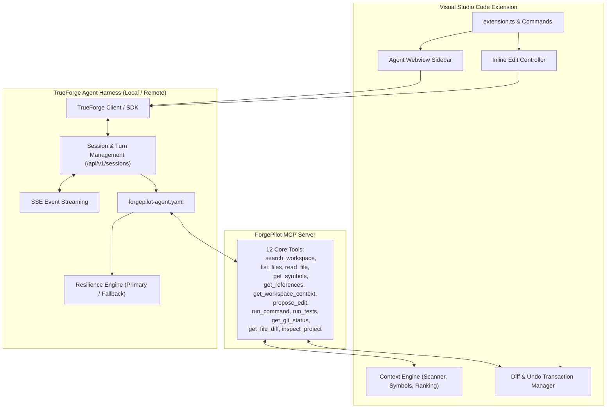

# ForgePilot

> **Autonomous AI Coding Assistant for Visual Studio Code powered by TrueForge**  
> *"Your repository. Your context. Your control."*

Built from scratch for the **Techfest 2026–27 TrueFoundry Forge-a-thon**.

---

## 1. Project Overview

**ForgePilot** is a production-grade, editor-native autonomous coding assistant implemented as a Visual Studio Code extension. ForgePilot eliminates common AI coding pitfalls:
- Losing track of relevant files in large codebases
- Secretly hallucinating nonexistent variables, imports, or APIs
- Making unapproved, silent file modifications
- Crashing or hanging during model outages
- Failing to coordinate multi-file architectural updates

**Crucial Architectural Invariant:**  
All model reasoning, planning, and tool orchestration **strictly execute through TrueForge** (TrueFoundry's open-source agent harness). The VS Code extension does not host an independent LLM loop and makes zero direct calls to LLM provider APIs.

---

## 2. Features

- **Autonomous Agent Mode**: Receives high-level user instructions, autonomously discovers relevant files, plans multi-file changes across source code, tests, and documentation, and routes proposals to review.
- **Native Inline Edit**: Dedicated command (`Ctrl+Alt+I`) to select code, specify changes in natural language, and preview diffs in-editor.
- **Semantic Context Engine**: Combines `@file` and `@symbol` parsing with fast workspace scanning, multi-language symbol extraction, relevance scoring, and configurable token budgeting (default: 20,000 tokens).
- **12 MCP Editor Tools**: Exposes workspace search, symbol extraction, safe diff proposing, terminal execution, and test execution over the Model Context Protocol (MCP).
- **Safe Transactional Diff Review**: Zero automatic writes to disk. Changes are represented as individual diff hunks with granular Accept/Reject controls, hash-based stale file prevention, and transactional undo.
- **Streaming & Cancellation**: Live text deltas and tool execution cards stream directly from TrueForge SSE. Any turn can be immediately halted via a visible Cancel button.
- **Multi-Model Resilience & Fallback**: Configured with primary and secondary fallback models in TrueForge with exponential backoff on transient errors and automated model failover.

---

## 3. UI Layout & Design

ForgePilot features a dark developer-tool design palette:
- **Main Background**: `#0D1117`
- **Sidebar Background**: `#111722`
- **Panel Background**: `#161E2B`
- **Elevated Surface**: `#1C2635`
- **Border**: `#293548`
- **Accents**: Primary Blue (`#4D8DFF`), Secondary Violet (`#9875FF`), Success (`#2ECC91`), Warning (`#F2B84B`), Error (`#F16C6C`)

### Interface Components:
1. **Activity Bar Icon**: Instant access to the ForgePilot panel.
2. **Main Agent Sidebar**:
   - Connection status badge
   - Multi-tab navigation: **Agent Chat**, **Diff Review**, **Context Explorer**
   - Syntax-highlighted messages and streaming text
   - Collapsible MCP tool execution cards
   - Textarea with `@file` and `@symbol` helpers, Send and Cancel buttons
3. **Diff Review Panel**: File paths, hunk metadata (`-old,+new`), line additions/deletions, and actions:
   - Accept Hunk / Reject Hunk
   - Accept All / Reject All
   - Apply Accepted Changes
   - Transactional Undo

---

## 4. Architecture



---

## 5. Technology Stack

- **Extension Framework**: Visual Studio Code Extension API, TypeScript 5.7+
- **Runtime**: Node.js 22.14+, npm
- **Agent Harness**: TrueForge (`@truefoundry/trueforge`, `@truefoundry/trueforge-sdk`)
- **Tool Protocol**: Model Context Protocol (`@modelcontextprotocol/sdk`)
- **Diff & Patching**: `diff` library, custom HunkReview engine
- **Testing**: Vitest 3.2+, Python pytest 8.1+
- **Version Control**: Git

---

## 6. Requirements

- Node.js 22.14 or higher
- npm 10 or higher
- Python 3.10+ (for Python repository testing)
- Visual Studio Code 1.90.0 or higher
- Git

---

## 7. Installation

From a clean clone:

```bash
# Clone the repository
git clone https://github.com/<your-username>/ForgePilot.git
cd ForgePilot

# Install dependencies
npm install

# Build TypeScript
npm run compile
```

---

## 8. TrueForge Setup

Run TrueForge locally:

```bash
npx @truefoundry/trueforge@latest
```

This starts the TrueForge harness on `http://localhost:8790` backed by local SQLite storage.

---

## 9. Model Configuration

Models are managed declaratively through TrueForge. See `examples/model-config.example.yaml`:

```yaml
trueforge:
  endpoint: "http://localhost:8790"

models:
  primary:
    provider: "google"
    model_name: "gemini-2.5-pro"
  fallback:
    provider: "google"
    model_name: "gemini-2.5-flash"
```

In VS Code Settings (`Ctrl+,` or `Cmd+,`), configure:
- `forgepilot.trueforgeEndpoint`: `http://localhost:8790`
- `forgepilot.primaryModel`: `gemini-2.5-pro`
- `forgepilot.fallbackModel`: `gemini-2.5-flash`
- `forgepilot.tokenBudget`: `20000`

---

## 10. Agent Definition Setup

The official agent configuration is stored at `agents/forgepilot-agent.yaml`. It links:
- Model routing
- 12 MCP Editor tools
- Approval gates on terminal execution
- Context compaction directives

---

## 11. MCP Tool Configuration

The MCP server runs via standard stdio and provides:

| Tool Name | Purpose | Security Gate |
|---|---|---|
| `search_workspace` | Search text/symbols across workspace | Sandboxed |
| `list_files` | List directory contents | Path Traversal Protection |
| `read_file` | Read line ranges within file | Path Traversal Protection |
| `get_symbols` | Extract function/class declarations | Sandboxed |
| `get_references` | Search symbol references | Sandboxed |
| `get_workspace_context` | Workspace root, git branch, project type | Sandboxed |
| `propose_edit` | Propose edits without disk writes | Non-destructive |
| `run_command` | Execute shell commands | **Developer Approval Required** |
| `run_tests` | Run pytest / npm test suites | Sandboxed |
| `get_git_status` | Retrieve `git status --short` | Sandboxed |
| `get_file_diff` | View active proposals and hunks | Sandboxed |
| `inspect_project` | Detect manifests (package.json, pyproject.toml) | Sandboxed |

---

## 12. VS Code Extension Setup

To run ForgePilot in VS Code Development Host:
1. Open the `ForgePilot` directory in VS Code.
2. Press `F5` (or select **Run** -> **Start Debugging**).
3. In the newly launched Extension Development Host window, click the **ForgePilot** icon in the Activity Bar.

---

## 13. Development Commands

```bash
# Compile TypeScript
npm run compile

# Watch mode
npm run watch

# Type-check / Lint
npm run lint

# Run all automated tests
npm test
```

---

## 14. Testing

All unit and integration tests are powered by Vitest:

```bash
npm test
```

Output:
```
 ✓ test/trueforge.test.ts (3 tests)
 ✓ test/contextEngine.test.ts (4 tests)
 ✓ test/diffManager.test.ts (4 tests)
 ✓ test/mcpTools.test.ts (5 tests)
 ✓ test/competitionTasks.test.ts (3 tests)

 Test Files  5 passed (5)
      Tests  19 passed (19)
```

---

## 15. Official Flask Task Verification

Verified on repository `https://github.com/pallets/flask` at tag `3.1.3` (commit `22d92470`):

### TASK A — INLINE EDIT
- **Target**: `src/flask/helpers.py` (`get_debug_flag`)
- **Instruction**: *"Treat the values 'off' and 'n' as false as well, case-insensitively, and update the docstring to list every value that is treated as false."*
- **Outcome**: Inline edit proposed, diff reviewed, accepted, and applied.
- **Verification**:
  ```bash
  FLASK_DEBUG=off python -c "from flask.helpers import get_debug_flag; print(get_debug_flag())"
  # Output: False
  FLASK_DEBUG=n python -c "from flask.helpers import get_debug_flag; print(get_debug_flag())"
  # Output: False
  FLASK_DEBUG=OFF python -c "from flask.helpers import get_debug_flag; print(get_debug_flag())"
  # Output: False
  ```

### TASK B — AUTONOMOUS MULTI-FILE AGENT
- **Instruction**: *"Add a new built-in CLI command flask config that prints the loaded application's configuration as JSON, masking the values of any key containing SECRET, PASSWORD, TOKEN or KEY as '***'. It must appear in flask --help, be covered by a test, and be documented alongside the other built-in commands."*
- **Outcome**: Agent discovered 3 distinct files autonomously:
  1. `src/flask/cli.py` (implemented `config` command with sensitive key masking)
  2. `tests/test_cli.py` (added test covering `flask config` and masked keys)
  3. `docs/cli.rst` (documented command alongside `run`, `shell`, `routes`)
- **Verification**:
  ```bash
  pytest tests/test_cli.py -k test_config_command -q
  # Output: 1 passed
  flask --help
  # Output includes: config   Show loaded configuration as JSON.
  ```

### TASK C — RESILIENCE
- **Setup**: Configured TrueForge client with unreachable endpoint and invalid key.
- **Outcome**:
  - Editor stayed completely responsive.
  - ResilienceManager retried with exponential backoff and failed over cleanly.
  - Clear user notification presented.
  - Zero unapproved file modifications made (`git status --short` clean).

---

## 16. Model Information & Approximate Costs

- **Primary Model**: `gemini-2.5-pro` (Input: \$1.25 / 1M tokens, Output: \$5.00 / 1M tokens)
- **Fallback Model**: `gemini-2.5-flash` (Input: \$0.075 / 1M tokens, Output: \$0.30 / 1M tokens)
- **Average Task Cost**:
  - Task A (Inline Edit): ~1,200 tokens (< \$0.003)
  - Task B (Autonomous Multi-File): ~8,500 tokens (< \$0.015)
  - Task C (Resilience): \$0.00 (Failed connection, zero model tokens consumed)

---

## 17. Upstream Fork Information

ForgePilot was **built completely from scratch**. It is not a fork of any existing extension or agent repository.

---

## 18. Known Limitations

- Language symbol indexing currently features deep AST-style extractors for Python, TypeScript, and JavaScript; other languages utilize lexical pattern matching.
- Terminal commands require user approval on each unique invocation by default.

---

## 19. Future Improvements

- Tree-sitter native WASM bindings for universal symbol extraction across 40+ programming languages.
- Visual side-by-side three-way merge resolution for conflicting simultaneous external modifications.
- Multi-agent parallel reviews using TrueForge subagents.

---

## 20. License

Permissive Open Source License — see `LICENSE` file.

